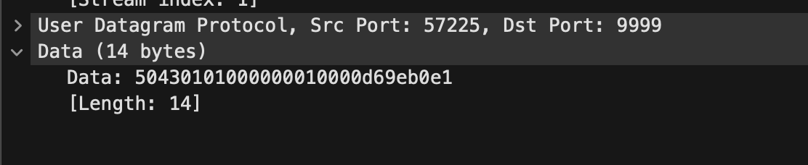
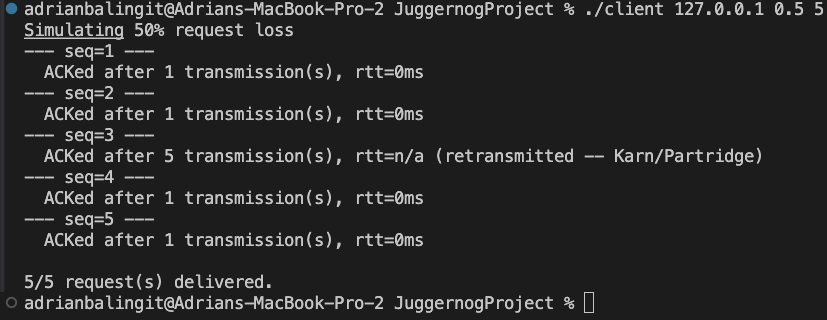
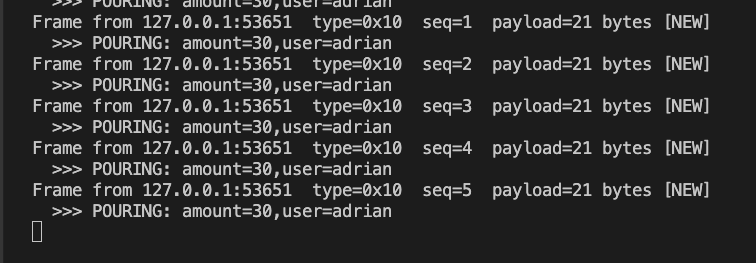
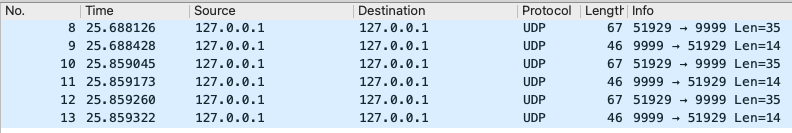
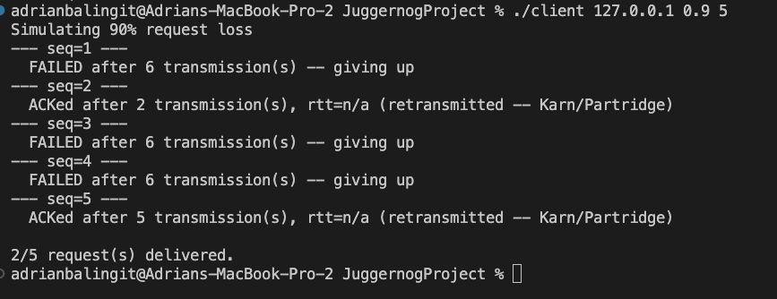
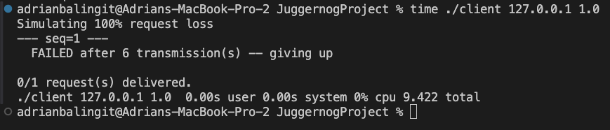
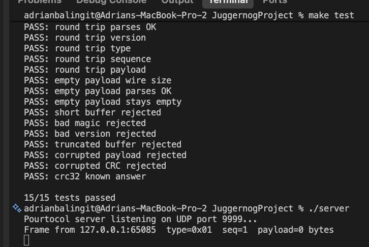

# Juggernog

[](https://github.com/vernonadrianbalingit/Juggernog-personal/actions/workflows/ci.yml)

Juggernog is a drink dispenser I'm building that you control over the network.
The plan is an ESP32 running a pump: tap an NFC card, it sends a request over
Wi-Fi, and it pours.

Right now I'm building the networking side on my laptop first. The client and
server talk using Pourtocol, a small binary protocol I wrote on top of UDP in
C++20. There are no libraries, just POSIX sockets.

## Progress

- [x] Phase 1: UDP echo server/client
- [x] Phase 2: binary frame format with CRC-32
- [x] Phase 3: reliability (ACKs, retransmit with exponential backoff, duplicate detection)
- [ ] Later: move it onto the ESP32 with FreeRTOS and hook up the pump

## Why UDP and not TCP?

The messages are tiny and the slow part is the pump, not the network. I want
short timeouts I can tune and memory use I can predict on a microcontroller,
and TCP doesn't really give me either. So I'm using UDP and adding only the
reliability I actually need. That's also the main thing I wanted to learn from
this project.

## Frame format

Everything multi-byte is big-endian.

```
 0       2     3      4              8        10           10+LEN
 +-------+-----+------+--------------+--------+--- ... ---+--------+
 | MAGIC | VER | TYPE |   SEQUENCE   |  LEN   |  PAYLOAD  | CRC-32 |
 |  (2)  | (1) | (1)  |     (4)      |  (2)   |  (LEN)    |  (4)   |
 +-------+-----+------+--------------+--------+--- ... ---+--------+
```

- **MAGIC**: always `0x50 0x43` ("PC"). Anything else sent to the port gets dropped right away.
- **VER**: protocol version, currently 1.
- **TYPE**: PING `0x01`, PONG `0x02`, ACK `0x03`, DISPENSE_REQ `0x10`, DISPENSE_ACK `0x11`, STATUS_REQ `0x20`, STATUS_RES `0x21`.
- **SEQUENCE**: matches replies to requests, and the server uses it to spot retransmits.
- **LEN**: payload length, max 1024.
- **CRC-32**: same polynomial Ethernet uses, computed over everything before it.

The header plus CRC is 14 bytes, so an empty PING is 14 bytes on the wire.
Here's one in Wireshark: `5043` magic, version `01`, type `01`, seq `00000001`,
len `0000`, then the CRC.



The parser checks things in this order and returns a different error code for
each: `TOO_SHORT`, `BAD_MAGIC`, `BAD_VERSION`, `LENGTH_MISMATCH`, `BAD_CRC`. It
has to check the header first, because it doesn't know where the CRC is until
it's read the length field. Fields are read with `memcpy` instead of casting
pointers, since unaligned reads can crash on some ARM chips.

## Reliability

UDP drops packets silently, so phase 3 adds the smallest thing that makes a
pour request actually arrive: stop-and-wait. The client sends one request and
doesn't move on until it gets an ACK with the same sequence number back.

```
 client                                server
   |--- DISPENSE_REQ seq=1 ------------->|  pour, remember seq=1
   |<------------------------ ACK seq=1 -|
   |
   |--- DISPENSE_REQ seq=2 ------X       |  lost
   |   (200ms timeout)                   |
   |--- DISPENSE_REQ seq=2 ------------->|  pour, remember seq=2
   |<------------------------ ACK seq=2 -|
   |
   |--- DISPENSE_REQ seq=3 ------------->|  pour, remember seq=3
   |       X <--------------- ACK seq=3 -|  lost
   |   (200ms timeout)                   |
   |--- DISPENSE_REQ seq=3 ------------->|  seq=3 again: DUPLICATE, don't pour
   |<------------------------ ACK seq=3 -|  still ACK it so the client stops
```

On the client side, `send_reliable()` sends the frame and then `poll()`s the
socket until a reply with the matching seq shows up or the timeout runs out.
On a timeout it sends again and doubles the wait: 200ms, 400ms, 800ms, 1600ms,
3200ms (capped there). Each timeout also gets +/-25% random jitter so a bunch
of clients that lost packets at the same moment don't all retry at the same
moment. After 5 retransmits it gives up and returns `false`.

RTT is only recorded when the first copy got the ACK. If the frame was
retransmitted there's no way to know which copy the ACK is answering, so that
sample gets thrown out (this is the Karn/Partridge rule from TCP).

On the server side there's a `DuplicateFilter` that keeps the last seq it saw
from each `(IP, port)`. Every valid frame comes back as `NEW`, `DUPLICATE`
(same seq as last time) or `STALE` (older seq). The server only pours on
`NEW`, but it ACKs everything, because the reason the client is retransmitting
might be that the last ACK got lost. So a request can show up on the wire more
than once but the pump only runs once, which is the part I actually care about.

To test any of this I needed packet loss, and loopback doesn't have any.
`lossy_sendto()` wraps `sendto()` and skips the call with some probability
(and still returns success, since that's what real UDP loss looks like from
the sender's side). The server uses it for ACKs and the client for requests, so
both directions can be tested from the command line.

### What it looks like

Client at 50% request loss. seq=3 needed 5 tries, but all 5 requests got
through:



The server for the same run. Each seq is `NEW` once and pours once, even the
one that was sent 5 times:



Wireshark on loopback during a 50% loss run. The dropped copies never reach the
wire (the drop happens before `sendto`), so what you see is the gap: frame 9
is the ACK for seq=1 at 25.688s, then nothing for ~170ms until the retransmit
of seq=2 goes out at 25.859s. That's the first timeout (200ms minus jitter).



At 90% loss some requests burn through all 6 transmissions and give up:



At 100% loss nothing gets through, and `time` shows the backoff schedule
adding up: 200 + 400 + 800 + 1600 + 3200 + 3200 = 9400ms, give or take
jitter.



## Files

| File | |
|---|---|
| `frame.h/.cpp` | Frame struct, `serialize()`, `parse()` |
| `crc32.h/.cpp` | table-based CRC-32 |
| `reliable.h/.cpp` | `send_reliable()` (stop-and-wait, backoff, jitter) and `lossy_sendto()` |
| `dedupe.h/.cpp` | `DuplicateFilter`, last seq per peer -> NEW / DUPLICATE / STALE |
| `server.cpp` | validates frames, pours on new DISPENSE_REQs, ACKs anything valid, PONGs PINGs |
| `client.cpp` | sends N DISPENSE_REQs with `send_reliable()` and prints transmissions + RTT |
| `test_frame.cpp` | unit tests |

## Building

Needs clang++ (C++20) on macOS or Linux.

```bash
make
make test
```

Run the server in one terminal and the client in another. Both take an
optional loss rate (0.0 to 1.0); the server drops that fraction of ACKs and
the client drops that fraction of requests.

```bash
./server              # or ./server 0.3 to drop 30% of ACKs
./client 127.0.0.1    # one dispense request
./client 127.0.0.1 0.3 5   # 5 requests, 30% of them dropped on purpose
```

```
Simulating 30% request loss
--- seq=1 ---
  ACKed after 1 transmission(s), rtt=0ms
--- seq=2 ---
  ACKed after 1 transmission(s), rtt=0ms
--- seq=3 ---
  ACKed after 3 transmission(s), rtt=n/a (Karn/Partridge its retransmitted cannot rtt)
--- seq=4 ---
  ACKed after 1 transmission(s), rtt=0ms
--- seq=5 ---
  ACKed after 1 transmission(s), rtt=0ms

5/5 request(s) delivered.
```

(rtt=0ms is just loopback being faster than a millisecond.)

On the server side, a retransmit caused by a lost ACK shows up like this:

```
Frame from 127.0.0.1:53651  type=0x10  seq=3  payload=21 bytes [NEW]
  >>> POURING: amount=30,user=adrian
Frame from 127.0.0.1:53651  type=0x10  seq=3  payload=21 bytes [DUPLICATE]
  (suppressed -- already handled seq=3)
```

If you send it something that isn't a Pourtocol frame, the server rejects it
and prints why:

```bash
echo "random garbage" | nc -u 127.0.0.1 9999
# Rejected packet from 127.0.0.1:54321 (15 bytes): BAD_MAGIC
```

## Tests

`make test` runs 49 checks: frame round trips (with and without a payload),
each way a frame can be rejected, the standard CRC-32 check value
(`"123456789"` -> `0xCBF43926`), the backoff schedule and jitter bounds, the
duplicate filter (including two peers with the same seq), and two end-to-end
tests that spin up a fake server on a second thread: one that ignores the
first two requests and checks the client retransmits until ACKed, and one
that never answers and checks the client gives up after the right number of
tries. CI runs them on every push.



## Known issues / TODO

- Stop-and-wait means one request in flight at a time. Fine for a pump, but
  it would be slow for anything chattier.
- The duplicate filter only remembers the last seq per peer, so it won't
  catch a very old packet that arrives after a newer one from the same client
  (it'll be marked STALE and ignored, which is the right thing anyway). It
  also never forgets peers, so the map grows with every new client port.
- The client restarts at seq=1 every run. It gets away with it because the
  kernel hands it a new source port each time, so the server sees it as a new
  peer. On the ESP32 the port will probably be fixed, so seq will need to be
  persisted or randomized.
- The CRC only catches corruption. It doesn't stop someone from forging a frame
  (there's no authentication).
- IPv4 only, and the server is single-threaded.
